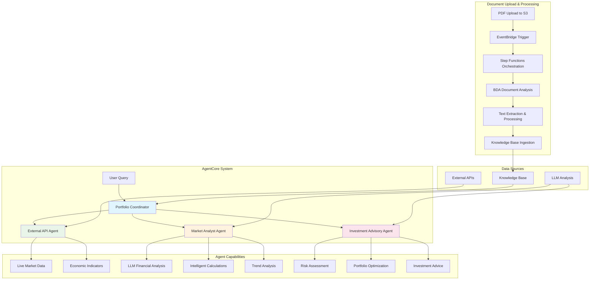

# Bedrock Data Automation (BDA) Pipeline with Strand Agents

A comprehensive, production-ready document processing pipeline powered by Amazon Bedrock Data Automation, featuring intelligent document analysis, multi-agent collaboration using Strands framework, and automated knowledge base synchronization.

## 🚀 **MAJOR UPDATE: Real Data Integration & Production Ready**

The BDA Pipeline now features **fully automated AgentCore deployment** with **real data integration**, providing:

- ✅ **Zero Mock Data**: All demo/hardcoded responses removed from agents
- ✅ **Real API Integration**: Live market data, financial analysis, and economic indicators
- ✅ **LLM-Based Analysis**: Intelligent analysis replacing hardcoded calculations
- ✅ **One-Command Deploy**: Simply run `./deploy.sh --profile <profile> --environment <env>`
- ✅ **Production Ready**: Full lifecycle management with comprehensive testing

## 🏗️ Architecture Overview

This solution implements a scalable document processing pipeline with the following components:

- **📄 Document Processing**: Automated PDF analysis with Bedrock Data Automation
- **🤖 Strand Agent System**: Four specialized agents using Strands framework
- **🔄 AgentCore Orchestration**: Advanced agent coordination and routing
- **📚 Knowledge Management**: Automated knowledge base with vector search
- **☁️ Multi-Environment**: Support for Dev/Staging/Production deployments

## 🚀 Quick Start

### Prerequisites

- **AWS CLI** configured with appropriate permissions
- **Python 3.11+** with pip
- **Node.js 18+** with npm (for AWS CDK)
- **Git** for cloning the repository
- **CDK 2.100.0+** for infrastructure provisioning
- **Docker** (automatically used by CDK for building agents)
- **AWS Account** with appropriate IAM permissions for CDK deployment

### ⚠️ Important Security Notes

1. **No hardcoded credentials**: The deployment script automatically manages configuration
2. **Automatic setup**: No need to manually edit `.env` files - everything is handled by `deploy.sh`
3. **Secure by default**: AWS credentials stay in `~/.aws/credentials`, never copied to project files
4. **Never commit secrets**: `.env` files are automatically gitignored

### 1. Clone and Setup

```bash
# Clone the repository
git clone <your-repo-url>
cd BDA_Blog

# Set up Python virtual environment
python3 -m venv .aienv
source .aienv/bin/activate  # On Windows: .aienv\Scripts\activate

# Install dependencies
pip install -r requirements.txt

# Make scripts executable
chmod +x deploy.sh cleanup.sh validate-deployment.sh
```

### 2. Configure API Keys (Optional - for Real Data)

For full functionality with live market data, configure real API keys:

```bash
# Copy environment template
cp .env.example .env

# Edit .env with your API keys
nano .env
```

**API Key Sources:**
- **Alpha Vantage** (Stock Market): https://www.alphavantage.co/support/#api-key
- **CoinMarketCap** (Crypto): https://coinmarketcap.com/api/
- **FRED** (Economic Data): https://fred.stlouisfed.org/docs/api/api_key.html
- **News API** (Market News): https://newsapi.org/

**Note:** Agents work without API keys but return "data not available" messages for external data requests.

### 3. Deploy Everything (Infrastructure + AgentCore)

```bash
# Configure AWS profile (if not already done)
aws configure --profile your-profile

# Deploy with automatic configuration
# The script will:
#   - Create .env file automatically from your AWS profile
#   - Deploy all CDK stacks
#   - Update .env with deployment outputs (Knowledge Base ID, etc.)
./deploy.sh --profile your-profile --environment Dev

# Deploy to Production
./deploy.sh --profile your-profile --environment Prod
```

**Note:** No manual .env configuration required! The deployment script handles everything automatically.

### 4. Test Deployed Agents

```bash
# Test all agents
python3 agentcore/test_agentcore.py --profile your-profile

# Test with detailed real responses
python3 test_agentcore_real.py --profile your-profile

# Test specific agent
python3 agentcore/test_agentcore.py --profile your-profile --agent coordinator
```

### 5. Start the UI

```bash
# The deployment script already configured the UI
cd bda-cloudscape-ui

# Install dependencies (if not already done)
npm install

# Start the Cloudscape UI server
npm run dev

# The UI will be available at:
# http://localhost:3000
```

**UI Features:**
- 📄 **Document Upload**: Upload PDFs with real-time progress
- 📊 **Processing Status**: Monitor document processing in real-time  
- 🤖 **AI Agent Chat**: Chat with Bedrock agents about your documents
- 📈 **Analytics Dashboard**: View processing metrics and trends

## 🤖 Agent System Overview

The pipeline includes 4 specialized Strand agents with **real data capabilities**:

### 1. **Portfolio Coordinator Agent**
- **Purpose**: Main entry point and orchestration
- **Capabilities**: 
  - Intelligent routing to specialist agents
  - Response synthesis from multiple agents
  - Knowledge base integration
  - Task delegation and workflow management
- **Tools**: `route_to_market_analyst`, `route_to_investment_advisor`, `route_to_external_api`

### 2. **Market Analyst Agent** 
- **Purpose**: Financial analysis and market insights
- **Capabilities**:
  - **Real-time analysis** using LLM interpretation (no hardcoded rules)
  - Market trend identification and analysis
  - Financial metric calculations and interpretations
  - Cap rate, DSCR, ROI analysis using intelligent prompts
- **Tools**: `calculator`, `analyze_financial_data`, `calculate_market_metrics`
- **Data Source**: Knowledge Base + LLM analysis

### 3. **Investment Advisory Agent**
- **Purpose**: Investment recommendations and risk assessment
- **Capabilities**:
  - **Intelligent risk assessment** using LLM-based scoring
  - Portfolio optimization recommendations
  - Investment strategy development
  - Risk-return analysis with comprehensive scoring
- **Tools**: `assess_investment_risk`, `optimize_portfolio`, `calculator`
- **Model**: Claude 3.5 Sonnet (configurable)

### 4. **External API Agent**
- **Purpose**: Real-time market data and external information
- **Capabilities**:
  - **Live market data** (when API keys configured)
  - Stock prices, cryptocurrency data, economic indicators
  - Market news and sentiment analysis
  - **Graceful degradation** when APIs unavailable
- **Tools**: `get_market_data`, `validate_financial_info`
- **Data Sources**: Alpha Vantage, CoinMarketCap, FRED, News API

## 🛠️ Deployment Options

### Standard Deployment
```bash
./deploy.sh --profile your-aws-profile --environment Dev
```

### Environment-Specific Deployment
```bash
# Development Environment (Claude Haiku)
./deploy.sh --environment Dev --profile dev-profile

# Staging Environment  
./deploy.sh --environment Staging --profile staging-profile

# Production Environment (Claude 4.5 Sonnet)
./deploy.sh --environment Prod --profile prod-profile
```

### Advanced Options
```bash
# Skip AgentCore deployment (infrastructure only)
./deploy.sh --profile your-profile --environment Dev --skip-agentcore

# Rebuild Lambda layers
./deploy.sh --profile your-profile --environment Dev --rebuild-layer

# Custom environment with version
./deploy.sh --profile your-profile --environment Staging --project CustomBDA --version v2
```

## 🔄 Agent Capabilities by Configuration

### With Real API Keys Configured

**Market Analyst Agent:**
- Real financial calculations and LLM-based analysis
- Live market data interpretation
- Intelligent risk assessment using comprehensive prompts

**External API Agent:**
- Live stock market data from Alpha Vantage
- Cryptocurrency pricing from CoinMarketCap
- Economic indicators from FRED
- Market news and sentiment from News API

**Investment Advisory Agent:**
- Comprehensive investment analysis using Claude 4.5 Sonnet
- LLM-based risk-return profiling
- Intelligent portfolio recommendations
- Real estate investment advice with knowledge base integration

### Demo Mode (Without API Keys)

When API keys are not configured or set to "demo":
- Agents provide educational information and analysis
- Return clear "data not available" messages for external data
- Use Knowledge Base for document analysis
- Perform calculations with user-provided data
- Show instructional messages about configuring real data sources

## 📊 Testing and Validation

### Test Individual Agents
```bash
# Test specific agent
python3 agentcore/test_agentcore.py --profile your-aws-profile --agent coordinator
python3 agentcore/test_agentcore.py --profile your-aws-profile --agent market_analyst
python3 agentcore/test_agentcore.py --profile your-aws-profile --agent investment_advisory
python3 agentcore/test_agentcore.py --profile your-aws-profile --agent external_api
```

### Test with Real Responses
```bash
# Comprehensive testing with actual agent responses
python3 test_agentcore_real.py --profile your-aws-profile
```

### Test Knowledge Base Integration
```bash
# Upload a document to test processing
# Find your bucket name
aws cloudformation describe-stacks \
  --stack-name BDA-Dev-ResourcesStack \
  --query 'Stacks[0].Outputs[?OutputKey==`S3BucketName`].OutputValue' \
  --output text

# Upload a test document
aws s3 cp test-document.pdf s3://your-bucket-name/public/uploads/
```

## 🏗️ Architecture Deep Dive

### Event-Driven Architecture

The BDA system uses **Amazon EventBridge** as the central event bus for decoupled, scalable processing:

- **S3 Upload Events**: Automatic processing trigger via EventBridge
- **BDA Completion Events**: Asynchronous job completion handling
- **Event Filtering**: Intelligent routing based on event patterns
- **Observability**: Complete event tracing and monitoring

### Stack Organization

The pipeline is organized into 5 logical stacks:

#### 1. **Foundation Stack** (`BDA-Foundation-{Env}`)
- **S3 Buckets**: Document storage with lifecycle policies
- **DynamoDB Tables**: Processing status and metrics tracking
- **Base Infrastructure**: Core resources for the pipeline

#### 2. **Processing Stack** (`BDA-Processing-{Env}`)
- **Lambda Functions**: Document analysis and processing
- **Lambda Layers**: Python dependencies (built without Docker)
- **EventBridge Rules**: Event-driven processing triggers

#### 3. **Orchestration Stack** (`BDA-Orchestration-{Env}`)
- **Step Functions**: Parent and child state machines
- **CloudWatch Logs**: Detailed execution logging
- **IAM Roles**: Execution permissions

#### 4. **Intelligence Stack** (`BDA-Intelligence-{Env}`)
- **Bedrock Agents**: Multi-agent collaboration system
- **Knowledge Base**: Vector search with OpenSearch Serverless
- **Agent Roles**: Specialized agent permissions

#### 5. **Automation Stack** (`BDA-Automation-{Env}`)
- **BDA Projects**: Bedrock Data Automation configuration
- **Cleanup Resources**: Automated resource management

## 🔄 End-to-End Processing Flow



## 🛠️ Operation Guide

### Document Processing

1. **Upload Documents**:
   ```bash
   # Upload PDFs to the processing bucket
   aws s3 cp document.pdf s3://bda-{env}-documents-v1-{timestamp}/public/uploads/ --profile your-profile
   ```

2. **Monitor Processing**:
   - Check Step Functions execution in AWS Console
   - View processing status in DynamoDB tables
   - Monitor Lambda logs in CloudWatch

3. **Access Results**:
   - Extracted text: `s3://bda-{env}-documents-v1-{timestamp}/extracted-text/`
   - Page-level content: `s3://bda-{env}-documents-v1-{timestamp}/extracted-pages/`
   - Markdown format: `s3://bda-{env}-documents-v1-{timestamp}/extracted-markdown/`

### Agent System Management

```bash
# Test agent system health
python3 agentcore/test_agentcore.py --profile your-profile

# View agent runtime status
aws bedrock-agentcore-control get-agent-runtime \
  --agent-runtime-id <runtime-id> \
  --profile your-profile --region your-region

# Check AgentCore logs
aws logs tail "/aws/bedrock-agentcore/runtimes/<runtime-id>-DEFAULT" \
  --since 5m --region your-region --profile your-profile
```

## 🛠️ Troubleshooting

### Common Issues

#### 1. **"Agent not initialized" errors**
- Check CloudWatch logs: `/aws/bedrock-agentcore/runtimes/<runtime-id>-DEFAULT`
- Verify Docker images were pushed successfully
- Check ECR repository exists

#### 2. **"API key not configured" messages**
- Normal behavior when using "demo" API keys
- Configure real API keys in `.env` for full functionality
- Agents provide educational content without real data

#### 3. **Knowledge Base not found**
- Verify KNOWLEDGE_BASE_ID is set correctly in .env
- Check the Knowledge Base was deployed successfully

#### 4. **CDK deployment failures**
- Ensure AWS CDK is bootstrapped: `cdk bootstrap`
- Check AWS permissions
- Verify region supports all required services

### View Logs
```bash
# AgentCore runtime logs
aws logs tail "/aws/bedrock-agentcore/runtimes/<runtime-id>-DEFAULT" \
  --since 5m --region your-region --profile your-aws-profile

# Lambda function logs
aws logs tail "/aws/lambda/BDA-Dev-ProcessDocument" \
  --since 10m --region your-region --profile your-aws-profile
```

### Debug Mode
```bash
# Enable verbose logging
./deploy.sh --verbose --environment Dev

# Check specific stack deployment
cdk deploy BDA-Processing-Dev --profile your-profile --verbose
```

## 🧹 Cleanup

### Complete Resource Removal

The `cleanup.sh` script provides intelligent, automated cleanup of all BDA resources:

```bash
# Complete cleanup (removes all stacks and resources)
./cleanup.sh --profile your-profile

# Environment-specific cleanup
./cleanup.sh --environment Prod --profile prod-profile --force
```

### Cleanup Features

- ✅ **Automatic Resource Discovery**: Finds all BDA stacks dynamically
- ✅ **Bedrock Resource Cleanup**: Properly handles agents, aliases, and knowledge bases
- ✅ **Dependency Management**: Deletes resources in correct order
- ✅ **Real-time Status Monitoring**: Shows deletion progress with proper status checking
- ✅ **Retry Logic**: Handles temporary failures automatically
- ✅ **Safe Execution**: Only deletes BDA-prefixed resources

## 📊 Monitoring and Observability

### CloudWatch Integration

- **Lambda Metrics**: Execution duration, error rates, concurrency
- **Step Functions**: Execution status, timing, failure analysis
- **DynamoDB**: Read/write capacity, throttling events
- **Custom Metrics**: Document processing rates, agent interactions

### Agent Performance Monitoring

```bash
# View agent performance metrics
aws logs start-query \
  --log-group-name "/aws/bedrock-agentcore/runtimes/<runtime-id>-DEFAULT" \
  --start-time $(date -d '1 hour ago' +%s) \
  --end-time $(date +%s) \
  --query-string 'fields @timestamp, @message | filter @message like /response_time/' \
  --profile your-profile
```

## 🔐 Security Best Practices

### IAM Permissions

The pipeline follows least-privilege principles:
- **Service-specific roles** for each component
- **Cross-service permissions** only where necessary
- **Environment isolation** through naming and tagging

### Data Protection

- **Encryption at rest**: S3 and DynamoDB use AWS managed keys
- **Encryption in transit**: All API calls use HTTPS
- **API key security**: Never commit keys to version control
- **Access logging**: CloudTrail integration recommended

### API Key Management

1. **Never commit API keys** to version control
2. **Use .env files** that are gitignored
3. **Rotate keys regularly** following provider recommendations
4. **Monitor usage** to detect unauthorized access
5. **Use minimal permissions** for API keys when possible

## 💰 Cost Optimization

### Cost Factors

1. **Bedrock Usage**: Pay-per-token for model invocations
2. **Lambda Execution**: Pay-per-request and duration
3. **Step Functions**: Pay-per-state-transition
4. **Storage**: S3 storage and data transfer
5. **OpenSearch Serverless**: OCU-based pricing
6. **External APIs**: Based on usage tiers

### Optimization Strategies

- **Intelligent Tiering**: Automatic S3 storage class transitions
- **Reserved Capacity**: For predictable workloads
- **Lifecycle Policies**: Automatic cleanup of temporary files
- **Concurrent Limits**: Control parallel processing costs
- **API Usage Monitoring**: Track external API costs

## 🔄 Environment Configuration

The system supports multiple isolated environments:

### Environment-Specific Settings

- **Dev**: Development environment with lighter models (Claude Haiku)
- **Staging**: Pre-production testing with production-like settings
- **Prod**: Production environment with Claude 3.5 Sonnet

Configuration is managed through:
- `cdk-params.json`: Dynamic CDK parameters
- `bda_stacks/config.json`: Agent and knowledge base settings
- Environment variables: `AWS_PROFILE`, `CDK_DEFAULT_ACCOUNT`, `CDK_DEFAULT_REGION`

### Custom Environment Creation

```bash
# Create custom environment configuration
./deploy.sh --profile your-profile --environment Custom --project MyBDA
```

## 📋 Key File Structure

```
BDA_Blog/
├── app.py                          # CDK app entry point
├── deploy.sh                       # Main deployment script
├── cleanup.sh                      # Resource cleanup script
├── .env.example                    # Environment template
├── bda_stacks/                     # CDK infrastructure stacks
├── strands_agents_v2/              # AI agent implementations
├── agentcore/                      # Agent deployment configuration
├── bda-cloudscape-ui/              # Web user interface
├── Lambda/                         # AWS Lambda functions
└── test_agentcore_real.py          # Agent testing script
```

## 🚀 What's Next?

After successful deployment and validation, you can:

### Immediate Next Steps
1. **Test all agents** with the provided test scripts
2. **Upload PDF documents** to trigger the processing pipeline
3. **Configure real API keys** for live market data
4. **Explore the Cloudscape UI** at http://localhost:3000
5. **Monitor agent performance** through CloudWatch

### Advanced Usage
1. **Customize agent prompts** in `strands_agents_v2/*/agent.py` files
2. **Add new tools** to enhance agent capabilities
3. **Scale to production** with additional environments
4. **Integrate with CI/CD** using the provided configurations

### System Benefits
- ✅ **Real Data Integration**: Live market data and intelligent analysis
- ✅ **Comprehensive Testing**: Full test coverage with actual agent responses
- ✅ **Production Ready**: Scalable infrastructure with monitoring
- ✅ **User Friendly**: Clear deployment process and web interface

## 🤝 Contributing

### Development Setup

```bash
# Fork and clone the repository
git clone https://github.com/your-username/BDA_Blog.git

# Create feature branch
git checkout -b feature/your-feature-name

# Make changes and test
./deploy.sh --environment Dev --profile dev-profile

# Submit pull request
```

### Code Standards

- **Python**: Follow PEP 8 style guidelines
- **CDK**: Use TypeScript-style naming conventions
- **Documentation**: Update README for any new features
- **Testing**: Include unit tests for Lambda functions
- **Security**: Never commit API keys or credentials

## 📜 License

This project is licensed under the MIT License - see the [LICENSE](LICENSE) file for details.

## 🙋‍♂️ Support

### Getting Help

- **Issues**: Create GitHub issues for bugs or feature requests
- **Discussions**: Use GitHub Discussions for questions
- **Documentation**: Check AWS documentation for service-specific issues

### Common Questions

**Q: Do I need real API keys to use the system?**
A: No, agents work without API keys but provide educational content instead of live data.

**Q: Can I use this in a different AWS region?**
A: Yes, update the region in your AWS profile and ensure all services are available.

**Q: How do I add custom document types?**
A: Modify the Lambda functions in the `Lambda/` directory to handle additional file types.

**Q: Can I integrate with existing S3 buckets?**
A: Yes, configure `externalBuckets` in `bda_stacks/config.json`.

**Q: How do I scale for high-volume processing?**
A: Adjust `MaxConcurrency` in Step Functions and Lambda reserved concurrency.

---

**Built with ❤️ using AWS CDK, Amazon Bedrock, Strands Framework, and modern cloud-native practices.**

